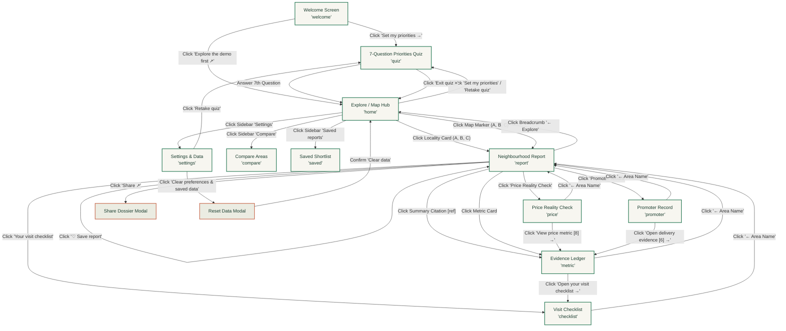

# Neighbrly · Complete Web Flow Structure & System Architecture

> **Document Version:** 1.0.0  
> **Applicable Codebase:** `Neighbrly/web` (`App.tsx`, `style.css`, `shared/core.ts`, `shared/demo.json`)  
> **Method Version:** `demo-bounds-v2`  
> **Scope:** Full interaction architecture, screen hierarchy, click-by-click transitions, functional subsystems, and the design/decision rationale behind every feature.

---

## Table of Contents

1. [Executive Overview & Philosophy](#1-executive-overview--philosophy)
2. [End-to-End System Navigation Flow (Mermaid Diagram)](#2-end-to-end-system-navigation-flow)
3. [Global App Shell & Persistent Systems](#3-global-app-shell--persistent-systems)
   - [3.1 Preview Bar & Device Switcher](#31-preview-bar--device-switcher)
   - [3.2 Persistent Left Sidebar](#32-persistent-left-sidebar)
   - [3.3 Top Header & Navigation Breadcrumb](#33-top-header--navigation-breadcrumb)
   - [3.4 System Notice Banner](#34-system-notice-banner)
   - [3.5 Global Modals (Share & Reset)](#35-global-modals-share--reset)
4. [Detailed Screen-by-Screen Flow & Click-Through Logic](#4-detailed-screen-by-screen-flow--click-through-logic)
   - [4.1 Welcome / Onboarding Screen (`welcome`)](#41-welcome--onboarding-screen-welcome)
   - [4.2 Home / Explore Hub (`home`)](#42-home--explore-hub-home)
   - [4.3 Priority Calibration Quiz (`quiz`)](#43-priority-calibration-quiz-quiz)
   - [4.4 Comprehensive Neighbourhood Report (`report`)](#44-comprehensive-neighbourhood-report-report)
   - [4.5 Evidence Ledger & Fact Sheet (`metric`)](#45-evidence-ledger--fact-sheet-metric)
   - [4.6 Price Reality Check Subsystem (`price`)](#46-price-reality-check-subsystem-price)
   - [4.7 Builder & Promoter Track Record (`promoter`)](#47-builder--promoter-track-record-promoter)
   - [4.8 Priority-Weighted Visit Checklist (`checklist`)](#48-priority-weighted-visit-checklist-checklist)
   - [4.9 Multi-Area Comparison Matrix (`compare`)](#49-multi-area-comparison-matrix-compare)
   - [4.10 Shortlist & Saved Reports (`saved`)](#410-shortlist--saved-reports-saved)
   - [4.11 Settings, Privacy & Local Data (`settings`)](#411-settings-privacy--local-data-settings)
5. [Core Subsystems & Computational Rationale](#5-core-subsystems--computational-rationale)
   - [5.1 Scoring Engine & Missing-Data Sensitivity Bounds](#51-scoring-engine--missing-data-sensitivity-bounds)
   - [5.2 Deterministic Citation & Summary Generator](#52-deterministic-citation--summary-generator)
   - [5.3 On-Device State Machine & Privacy-First Architecture](#53-on-device-state-machine--privacy-first-architecture)
   - [5.4 Interactive Map Subsystem](#54-interactive-map-subsystem)
6. [Master Click & Transition Matrix](#6-master-click--transition-matrix)

---

## 1. Executive Overview & Philosophy

**Neighbrly** is an evidence-led neighbourhood evaluation platform created specifically for home buyers and renters evaluating residential areas before signing an agreement.

### The Core Problem it Solves
In Indian residential real estate (and emerging markets broadly), property marketing is dominated by broker hype, builder brochures, and subjective forum opinions. Key livability factors (air quality, transit walking times, builder delivery delays, registered transaction prices) are either hidden, exaggerated, or fragmented across opaque government registries (e.g., MahaRERA, IGR Maharashtra).

### The Three Foundational Pillars
1. **Independent (No Commission):** Zero monetization from builders, brokers, or lead-generation. Scores reflect impartial data without sponsored placements.
2. **Transparent & Auditable:** Every metric and summary assertion is tied to a specific evidence reference `[ref]` with date, collection source, raw observation, and coverage area.
3. **Honest About Data Gaps:** When data is missing, Neighbrly **never fabricates or predicts** values using AI or statistical averages. Instead, it explicitly marks data as missing, excludes it from observed scores, and computes **sensitivity bounds (`lo`–`hi`)** that visualize how missing metrics could alter the verdict.

---

## 2. End-to-End System Navigation Flow



---

## 3. Global App Shell & Persistent Systems

The web application is wrapped in an ergonomic two-tier shell (`.nb-app` with `.nb-sidebar` and `.nb-content`) that remains accessible on all screens.

### 3.1 Preview Bar & Device Switcher
- **What it includes:**
  - `INTERACTIVE PREVIEW · v0.1` status badge.
  - Device toggle buttons: `Web` vs `Android layout`.
- **Why it exists:**
  Neighbrly was developed simultaneously as a desktop/tablet web platform and an Android native app (via Expo/React Native). The device switcher applies `.nb-phone` styles to constrain the layout to an authentic mobile phone viewport (390px max-width, elevated drop shadow, rounded bezel preview).
- **On Click Interaction:**
  - **Click `Web`:** Updates `s.device = 'web'`. The layout expands to full-width responsive desktop/tablet grid with a left navigation rail.
  - **Click `Android layout`:** Updates `s.device = 'phone'`. The layout shifts to a single-column mobile view, collapsing the sidebar into top/bottom touch navigation.
  - **Why:** Allows stakeholders, buyers, and developers to immediately verify touch ergonomics, button reachability, and mobile font readability on desktop without launching an Android emulator.

### 3.2 Persistent Left Sidebar (`nb-sidebar`)
- **What it includes:**
  1. **Brand Mark (`n• neighbrly.`):** The official product logo and title.
  2. **Active Pilot Badge (`● Mumbai pilot ⌄`):** Visual indicator of the geographic data boundary.
  3. **Main Navigation Rail:** 4 core destinations:
     - `Explore (⌂)`
     - `Compare (⇄)`
     - `Saved reports (♡)` with a real-time counter badge showing saved count (e.g. `2`).
     - `My priorities (☷)`
  4. **Trust Card:** *"Clarity, without the commission. No builder or broker input in scores."*
  5. **Settings Link:** `⚙ Settings & data`.
- **Why it exists:**
  Provides instant 1-click navigation between the primary exploratory surfaces. The trust card acts as a constant psychological reassurance of editorial independence.
- **On Click Interactions:**
  - **Click Brand Mark:** Invokes `go('home')`. Returns user to the discovery hub.
  - **Click `Explore`:** Invokes `go('home')`. Opens area discovery & map.
  - **Click `Compare`:** Invokes `go('compare')`. Opens side-by-side trade-off matrix.
  - **Click `Saved reports`:** Invokes `go('saved')`. Opens shortlist of saved reports.
  - **Click `My priorities`:** Invokes `quiz()`. Resets the quiz pointer and launches Question 1.
  - **Click `⚙ Settings & data`:** Invokes `go('settings')`. Opens data policies, privacy, weights, and data reset.

### 3.3 Top Header & Navigation Breadcrumb
- **What it includes:**
  - Dynamic page title corresponding to the active screen (`titles[s.screen]`).
  - `DEMO DATA` badge indicating simulated figures.
  - User avatar button labeled `You`.
  - Hierarchical breadcrumb (`nb-breadcrumb`) on all sub-screens (`metric`, `price`, `promoter`, `checklist`, `compare`, `saved`, `settings`).
- **Why it exists:**
  Maintains spatial orientation so the user always knows where they are in the deep report hierarchy, and provides a 1-click escape route back to the parent report or explore hub.
- **On Click Interactions:**
  - **Click `You` Avatar:** Invokes `go('settings')`. Quick-jump to user weights and storage preferences.
  - **Click Breadcrumb `← Area Name` (from detail screens):** Invokes `go('report')`. Returns directly to the area report without resetting user weights or scroll progress.
  - **Click Breadcrumb `← Explore` (from top-level screens):** Invokes `go('home')`. Returns to the main map and locality list.

### 3.4 System Notice Banner (`nb-notice`)
- **What it includes:**
  - Contextual status message (e.g., *"Your priorities are set. Reports now use your weights."*, *"Outside demo coverage"*, *"Report text copied"*).
  - Dismiss button (`×`).
- **Why it exists:**
  Provides accessible, non-intrusive feedback (`role="status"`) when asynchronous actions (clipboard copy, storage fallbacks, weight updates) execute.
- **On Click Interaction:**
  - **Click `×`:** Clears `notice` state to hide the banner.

### 3.5 Global Modals (`nb-modal-shade`)
The application features an accessible modal dialog system with focus trapping and `Escape` key listeners.

#### A. Share Modal (`modal === 'share'`)
- **What it includes:**
  - Read-only formatted text dossier with area name, match score, band, coverage %, bounds, summary citations, raw ledger references, and disclaimers.
  - Primary button: `Copy report`.
  - Secondary button: `Device share ↗`.
  - Helper note explaining that PDF export and WhatsApp integration are roadmap items.
- **Why it exists:**
  Home buying is inherently collaborative (couples, families, co-investors). This enables immediate sharing of the entire audit trail into WhatsApp, iMessage, or email without requiring the recipient to sign up or log in.
- **On Click Interactions:**
  - **Click `Copy report`:** Writes formatted plaintext to the system clipboard via `navigator.clipboard.writeText`. Displays notification toast *"Report text copied"*, then auto-closes modal.
  - **Click `Device share ↗`:** Calls native Web Share API (`navigator.share`). On supported mobile browsers, opens the native OS share sheet (WhatsApp, Gmail, Messages).
  - **Click `×` or press `Escape`:** Closes dialog and returns focus to the calling "Share" button.

#### B. Reset Confirmation Modal (`modal === 'reset'`)
- **What it includes:**
  - Warning heading: *"Start fresh?"*.
  - Explicit warning text: *"This removes your priorities, saved snapshots, checkmarks and correction draft from this preview."*
  - Destructive action: `Clear data` (red button).
  - Cancel action: `Keep my data`.
- **Why it exists:**
  Protects users from accidental data loss while giving complete GDPR/privacy control to wipe all on-device footprints.
- **On Click Interactions:**
  - **Click `Clear data`:** Resets state back to `initial` defaults, clears `localStorage['neighbrly.preview.v2']`, wipes checkmarks, resets quiz, closes modal, and lands user on `home`.
  - **Click `Keep my data` or `×`:** Aborts deletion and closes modal safely.

---

## 4. Detailed Screen-by-Screen Flow & Click-Through Logic

### 4.1 Welcome / Onboarding Screen (`welcome`)

```
+-----------------------------------------------------------------------+
|  [Eyebrow] A LITTLE LOCAL KNOWLEDGE GOES A LONG WAY                  |
|  Know the neighbourhood. Before you sign.                            |
|  A clearer view of the places you're considering...                  |
|                                                                       |
|  [01 Independent]        [02 Transparent]         [03 Honest on gaps]|
|                                                                       |
|  [ Set my priorities → ]               [ Explore the demo first ↗ ]   |
|                                                                       |
|  7 quick questions · No account needed · Stays on this device         |
+-----------------------------------------------------------------------+
```

- **Screen ID:** `'welcome'`
- **What this system includes:**
  - Hero narrative establishing the value proposition before any complex metrics are shown.
  - Three trust pillars explaining independence, data transparency, and handling of missing evidence.
  - Two distinct primary onboarding call-to-actions (CTAs).
  - Privacy commitment (zero account creation, client-side only).
- **Why this system exists:**
  Real estate platforms usually demand an immediate phone number or email to sell as a broker lead. Neighbrly establishes immediate trust by demonstrating that it is an analytical tool, not a sales funnel.
- **Interactive Elements & Clicks:**
  1. **Click `Set my priorities →` (Primary CTA):**
     - **Navigates to:** `'quiz'` screen.
     - **Why:** The recommended path. Tailors every subsequent report score to the user's specific lifestyle priorities.
  2. **Click `Explore the demo first ↗` (Secondary CTA):**
     - **Navigates to:** `'home'` screen.
     - **Why:** Low-friction bypass for exploratory users who want to see raw data and maps before committing to a 7-question quiz.

---

### 4.2 Home / Explore Hub (`home`)

```
+-----------------------------------------------------------------------+
|  A better place starts with a clearer picture.                        |
|  [Search input: "Search demo localities A, B or C"           ] [×]    |
|                                                                       |
|  +-----------------------------------------------------------------+  |
|  | [☷] A good neighbourhood means something different to everyone  |  |
|  |     Your reports currently use equal weights.                   |  |
|  |     [ Set my priorities → ]                                     |  |
|  +-----------------------------------------------------------------+  |
|                                                                       |
|  [Explore areas]                          [Around Mumbai Map]         |
|  +-------------------------------------+  +-------------------------+ |
|  | [A] Bandra West - Heritage & Cafes  |  | [Leaflet Ward Polygons] | |
|  |     78/100 · Strong · 6 of 7 metrics|  |  (A)     (B)            | |
|  |     [Saved]                         |  |               (C)       | |
|  +-------------------------------------+  +-------------------------+ |
|  | [B] Powai - Lakeview & Tech Hub     |  | Tap a marker to explore | |
|  +-------------------------------------+  +-------------------------+ |
+-----------------------------------------------------------------------+
```

- **Screen ID:** `'home'`
- **What this system includes:**
  - Real-time search filter for localities.
  - Priority Banner: Shows either an invitation to take the quiz (if uncompleted) or the user's calibrated top 3 priorities (if completed).
  - Two-column responsive layout:
    - **Left column:** List of locality cards with overall match score, qualitative band tag (`Strong`, `Mixed`, `Weak`), metric completeness count, weight coverage %, and saved status.
    - **Right column:** Interactive Leaflet ward map rendered from GeoJSON, with 900m boundary circles and clickable locality pins (A, B, C).
- **Why this system exists:**
  Acts as the primary mission control. Combines tabular card browsing with spatial geographic context.
- **Interactive Elements & Clicks:**
  1. **Type in Search Input:**
     - **Action:** Updates `search` query state.
     - **Result:** Filters area cards in real-time matching `name` or `tagline`.
     - **Why:** Fast retrieval when the user already knows their target locality.
  2. **Click Clear Search (`×`):**
     - **Action:** Resets `search` to `''`. Restores full list.
  3. **Click `Set my priorities →` / `Retake quiz` in Priority Banner:**
     - **Navigates to:** `'quiz'` screen.
     - **Why:** Allows on-the-fly recalibration of preferences directly from the explore view.
  4. **Click any Locality Card (e.g. Bandra West):**
     - **Navigates to:** `'report'` screen for that area (`s.area = 'a'`).
     - **Why:** Direct dive into the full evaluation dossier.
  5. **Click a Map Marker (A, B, or C):**
     - **Navigates to:** `'report'` screen for the selected area.
     - **Why:** Spatial affordance; users who think geographically can click the map directly.
  6. **Click outside any demo marker on the map:**
     - **Action:** Triggers `onOutside()`. Displays toast: *"Outside demo coverage. Choose marker A, B or C to explore an illustrative report."*
     - **Why:** Prevents confusion when clicking unmapped administrative wards.

---

### 4.3 Priority Calibration Quiz (`quiz`)

```
+-----------------------------------------------------------------------+
|  MAKE IT PERSONAL                                      [Exit quiz ×]  |
|  Question 1 of 7                                                      |
|  [======================                                    ] 14%     |
|                                                                       |
|  Which matters more to you?                                           |
|  There's no right answer. Choose what matters more to you.            |
|                                                                       |
|  +-----------------------------------------------------------------+  |
|  | [A] A short commute                                           → |  |
|  +-----------------------------------------------------------------+  |
|  | [B] Lots of greenery                                          → |  |
|  +-----------------------------------------------------------------+  |
|                                                                       |
|  [← Previous question]                                                |
+-----------------------------------------------------------------------+
```

- **Screen ID:** `'quiz'`
- **What this system includes:**
  - 7 balanced pairwise trade-off questions covering all 7 metrics:
    1. *Transit* vs *Greenery*
    2. *Schools* vs *Value (Lower price)*
    3. *Air quality* vs *Builder delivery safety*
    4. *Safety proxies* vs *Transit access*
    5. *Greenery* vs *Schools*
    6. *Lower price* vs *Air quality*
    7. *Builder track record* vs *Safety proxies*
  - Animated progress bar (`role="progressbar"`).
  - Previous question link (`← Previous question`) for undoing mistakes.
  - "Exit quiz ×" shortcut to return to explore without saving incomplete weights.
- **Why this system exists:**
  Rating importance from 1 to 10 on a slider is cognitively difficult and leads users to rank everything as "10/10". Forced pairwise trade-offs force realistic compromises (e.g., commute vs green space), creating mathematically balanced weights (1 to 3+ per metric).
- **Interactive Elements & Clicks:**
  1. **Click Choice [A] or [B]:**
     - **Action:** Calls `answer(selectedMetricId)`.
     - **If questions remain (<7):** Advances to next question with updated progress bar.
     - **If 7th question answered:**
       - Computes updated weight vector via `weightsFromAnswers()`.
       - Sets `quizDone = true`.
       - Navigates to `'home'`.
       - Displays notification: *"Your priorities are set. Reports now use your weights."*
     - **Why:** Immediate real-time re-weighting of every score across the entire app.
  2. **Click `← Previous question`:**
     - **Action:** Pops the last answer from `answers` array.
     - **Result:** Decrements step counter and returns to the prior question state.
     - **Why:** Prevents user frustration if they accidentally tap the wrong option on touchscreens.
  3. **Click `Exit quiz ×`:**
     - **Navigates to:** `'home'`. Discards partial quiz progress without altering existing weights.

---

### 4.4 Comprehensive Neighbourhood Report (`report`)

```
+-----------------------------------------------------------------------+
|  [Eyebrow] YOUR NEIGHBOURHOOD REPORT                                  |
|  Bandra West                          [♡ Save report]   [ Share ↗ ]   |
|  Heritage lanes, sea breeze, and high lifestyle premiums              |
|                                                                       |
|  +----------------------------------+  +----------------------------+ |
|  | MATCH FOR YOUR PRIORITIES        |  | THE SHORT VERSION          | |
|  | 78/100 · Strong                  |  | What stands out for you    | |
|  | [==============          ]       |  | • Transit is a strength [2]| |
|  | 6 of 7 metrics · 86% weight cov. |  | • Green cover is mixed  [4]| |
|  | Missing bounds: 67–81            |  | • Air quality is mixed  [1]| |
|  | Evidence dated 1 Oct 2026 [DEMO] |  |                            | |
|  +----------------------------------+  +----------------------------+ |
|                                                                       |
|  BEHIND THE SCORE (Higher is always more favourable)                  |
|  +-------------+ +-------------+ +-------------+ +------------------+ |
|  | [1] Air     | | [2] Transit | | [3] Schools | | [4] Green Cover  | |
|  | 62 · Mixed  | | 88 · Strong | | 84 · Strong | | 58 · Mixed       | |
|  +-------------+ +-------------+ +-------------+ +------------------+ |
|  | [5] Safety  | | [6] Delivery| | [8] Price   |                      | |
|  | 74 · Mixed  | | 68 · Mixed  | | No data yet |                      | |
|  +-------------+ +-------------+ +-------------+                      |
|                                                                       |
|  A CLOSER LOOK                                                        |
|  [₹ Price Reality Check]     [▦ Promoter record]   [✓ Visit checklist]|
+-----------------------------------------------------------------------+
```

- **Screen ID:** `'report'`
- **What this system includes:**
  1. **Top Actions:** Toggle Save (`♡ Save report` / `♥ Saved`) and Share (`Share ↗`).
  2. **Personalized Match Score Panel:**
     - Weighted composite score out of 100.
     - Qualitative rating band tag (`Strong` >=75, `Mixed` >=55, `Weak` <55).
     - Color-coded progress bar.
     - Metrics coverage ratio (e.g. 6 of 7 metrics, 86% weight coverage).
     - **Missing-data sensitivity bounds (`lo`–`hi`):** Explicit bounds if missing metrics were 0 or 100.
  3. **The Short Version (Deterministic Summaries):**
     - Top 3 salient observations generated deterministically based on user weights and deviation from average.
     - Interactive bracketed reference chips (`[1]`, `[2]`, `[6]`).
  4. **Behind the Score (Metrics Grid):**
     - 7 interactive cards for each evaluated dimension.
     - Explicit handling for missing metrics (*"No data yet · tap to see why"*).
  5. **A Closer Look (Deep Dive Launchers):**
     - 3 specialized sub-systems: Price Reality Check, Promoter Record, and Visit Checklist.
- **Why this system exists:**
  This is the core decision dashboard. It aggregates multi-dimensional data into a clear hierarchy: headline verdict -> key drivers -> metric details -> actionable next steps.
- **Interactive Elements & Clicks:**
  1. **Click `♡ Save report` / `♥ Saved`:**
     - **Action:** Calls `toggleSave()`.
     - **Result:** Toggles area snapshot in `s.saved` array in `localStorage`. Updates button label to `♥ Saved` and increments sidebar counter badge.
     - **Why:** Allows users to bookmark candidate localities to review later in the shortlist.
  2. **Click `Share ↗`:**
     - **Action:** Calls `share()`.
     - **Result:** Opens the Share Modal with complete formatted text and citations.
     - **Why:** Enables instant forwarding to co-buyers and family.
  3. **Click any Summary Citation Chip `[ref]` (e.g. `[2]`):**
     - **Action:** Calls `evidence(metricId)`.
     - **Navigates to:** `'metric'` screen focused on that specific metric.
     - **Why:** Zero-trust architecture: every claim can be audited down to the source in one click.
  4. **Click any Metric Card in the Grid:**
     - **Action:** Calls `evidence(metricId)`.
     - **Navigates to:** `'metric'` screen for that metric.
     - **Why:** Drill down into exact readings, collection dates, and physical verification advice.
  5. **Click `Price Reality Check` Card (`₹`):**
     - **Navigates to:** `'price'` screen for the active locality.
     - **Why:** Test whether a seller's asking price is realistic against registered transaction medians.
  6. **Click `Promoter record` Card (`▦`):**
     - **Navigates to:** `'promoter'` screen for the active locality.
     - **Why:** Inspect the builder's past delivery history and RERA complaints.
  7. **Click `Your visit checklist` Card (`✓`):**
     - **Navigates to:** `'checklist'` screen for the active locality.
     - **Why:** Convert metric weaknesses and missing data into an on-site physical inspection plan.

---

### 4.5 Evidence Ledger & Fact Sheet (`metric`)

```
+-----------------------------------------------------------------------+
|  [Breadcrumb: ← Bandra West / Evidence ledger]                        |
|  [Eyebrow] FACT LEDGER · REFERENCE [1]                                |
|  Air quality                                                          |
|  Typical particulate levels, as a percentile among Mumbai areas.      |
|                                                                       |
|  +-----------------------------------------------------------------+  |
|  | 62/100 · Mixed                                                  |  |
|  | Reading:          PM2.5 annual mean 48 ug/m3                    |  |
|  | Source:           Demo pollution monitoring sensor net [DEMO]   |  |
|  | Observation date: 1 October 2026                                |  |
|  | Coverage:         Ward H/W · illustrative                       |  |
|  | Locality:         Bandra West                                   |  |
|  | Method:           Invented 0-100 fixture; higher is favourable. |  |
|  +-----------------------------------------------------------------+  |
|                                                                       |
|  TAKE THE EVIDENCE FURTHER                                            |
|  Visit at rush hour and check for dust, traffic smoke and smell.      |
|  [ Open your visit checklist → ]                                      |
+-----------------------------------------------------------------------+
```

- **Screen ID:** `'metric'`
- **What this system includes:**
  - Complete provenance ledger for the selected metric: raw reading, source organization, observation timestamp, geographic coverage scope, and normalization methodology.
  - **Missing Data State:** If the metric has `null` data in this locality:
    - Renders warning block: *"No data yet"*.
    - Explains why data is missing and why it was excluded from the composite score.
    - Highlights how its missing weight widens the sensitivity bounds.
  - Physical inspection advice explaining how to verify this metric in the real world.
- **Why this system exists:**
  Demolishes "black-box" scoring. Most property portals assign arbitrary 4.5-star ratings without revealing the underlying data. Neighbrly proves every score or explicitly justifies its absence.
- **Interactive Elements & Clicks:**
  1. **Click Breadcrumb `← Area Name`:**
     - **Navigates to:** `'report'` screen.
     - **Why:** Seamless return to the main locality dashboard.
  2. **Click `Open your visit checklist →`:**
     - **Navigates to:** `'checklist'` screen.
     - **Why:** Channels the user's analytical insight into practical on-site inspection tasks.

---

### 4.6 Price Reality Check Subsystem (`price`)

```
+-----------------------------------------------------------------------+
|  [Breadcrumb: ← Bandra West / Price Reality Check]                    |
|  VALUE · PRICE REALITY CHECK                                          |
|  Put the asking price in perspective.                                 |
|  Compare like-for-like registered transactions.                       |
|                                                                       |
|  +-----------------------------------------------------------------+  |
|  | Seller's asking price · ₹ per sq ft                             |  |
|  | [ 46000                                                       ] |  |
|  +-----------------------------------------------------------------+  |
|                                                                       |
|  +-----------------------------------------------------------------+  |
|  | Registered median:   ₹42,000 / sq ft   [====================    ] |  |
|  | Seller asking price: ₹46,000 / sq ft   [======================= ] |  |
|  |                                                                 |  |
|  | 10% above the sample median                                     |  |
|  | Based on 18 invented deals · Oct 2025 - Sep 2026.               |  |
|  +-----------------------------------------------------------------+  |
|                                                                       |
|  [ View price metric [8] → ]                                          |
+-----------------------------------------------------------------------+
```

- **Screen ID:** `'price'`
- **What this system includes:**
  - Interactive numeric input: *"Seller’s asking price · ₹ per sq ft"*. Pre-populated with the locality's baseline asking figure.
  - Real-time comparison engine calculating percentage deviation:
    $$\text{Deviation \%} = \left(\frac{\text{Asking}}{\text{Median}} - 1\right) \times 100$$
  - Visual comparison bars comparing the seller's asking price to the government-registered median price per square foot.
  - Dynamic risk styling: Changes to caution or risk color if the asking price exceeds the registered median by more than 8%.
  - Missing-data fallback: If an area lacks transaction data, shows an explicit notice and link to understand why transaction records are insufficient.
- **Why this system exists:**
  Sellers and brokers frequently quote inflated asking prices. This tool gives buyers an objective anchor based on registered sale deeds before entering price negotiations.
- **Interactive Elements & Clicks:**
  1. **Edit Asking Price Input:**
     - **Action:** Updates `asking` state on keystroke.
     - **Result:** Dynamically recalculates the deviation percentage, updates the bar fill widths, and toggles risk badges in real time. Input validation rejects values <= 0 or > ₹10,00,000.
     - **Why:** Lets buyers test specific property quotes they received from brokers in that area.
  2. **Click `View price metric [8] →`:**
     - **Navigates to:** `'metric'` screen for the `value` dimension.
     - **Why:** Check the raw transaction sample size and registry source.

---

### 4.7 Builder & Promoter Track Record (`promoter`)

```
+-----------------------------------------------------------------------+
|  [Breadcrumb: ← Bandra West / Promoter record]                        |
|  DELIVERY · PROMOTER RECORD                                           |
|  The track record behind the promise.                                 |
|  Apex Horizons Ltd · fictitious promoter                              |
|                                                                       |
|  +-------------------+ +-------------------+                          |
|  | 6                 | | 4 of 6            |                          |
|  | Sample projects   | | Delayed projects  |                          |
|  +-------------------+ +-------------------+                          |
|  | 14 mo             | | 12                |                          |
|  | Avg delay months  | | Sample complaints |                          |
|  +-------------------+ +-------------------+                          |
|                                                                       |
|  [ Open delivery evidence [6] → ]                                     |
+-----------------------------------------------------------------------+
```

- **Screen ID:** `'promoter'`
- **What this system includes:**
  - Builder attribution record across registered projects:
    - Total registered projects.
    - Delayed project count.
    - Average delay duration (in months) among delayed projects.
    - Official consumer/buyer complaint count filed under RERA.
  - **No Matched Promoter State:** If no project-to-promoter match exists:
    - Renders strict disclaimer: *"There is no confirmed project-to-promoter match for this demo locality. We cannot attribute another builder’s record to this property."*
- **Why this system exists:**
  Project delivery delays and builder insolvency are the #1 financial risk for under-construction Indian real estate. This subsystem isolates the corporate track record across all past developments.
- **Interactive Elements & Clicks:**
  1. **Click `Open delivery evidence [6] →`:**
     - **Navigates to:** `'metric'` screen for `delivery`.
     - **Why:** View the RERA data registry reference and observation date.

---

### 4.8 Priority-Weighted Visit Checklist (`checklist`)

```
+-----------------------------------------------------------------------+
|  [Breadcrumb: ← Bandra West / Visit checklist]                        |
|  TAKE A LITTLE CLARITY WITH YOU                                       |
|  Your visit checklist                                                 |
|  For Bandra West. Ordered by your priorities.                         |
|  1 of 5 checked                                                       |
|                                                                       |
|  [X] 1. Check air quality                                             |
|         Visit at rush hour and check for dust, traffic smoke...       |
|                                                                       |
|  [ ] 2. Verify green cover                                            |
|         No data yet. Check how much open space is protected...        |
|                                                                       |
|  [ ] 3. Check project registration                                    |
|         Ask for the RERA registration number and read complaint hist. |
|                                                                       |
|  [ ] 4. Ask for registered deals                                      |
|         Compare recent registered sale deeds with the asking price.   |
+-----------------------------------------------------------------------+
```

- **Screen ID:** `'checklist'`
- **What this system includes:**
  - Dynamically assembled on-site checklist tailored specifically to the selected locality:
    - Metrics with **No data** (`value === null`) are prioritized with instructions on what to physically inspect.
    - Metrics with **Low/Mixed scores** (<55) generate targeted verification tasks.
    - **Sorted by user preference weights:** If the user cares most about air quality, air quality checks appear at the very top.
    - Two universal legal/title checks: RERA registration verification and registered sale deed inspection.
  - Persistent interactive checkmarks: Checkmark state is stored in `s.checks[areaId + ':' + checkId]`.
  - Progress counter: e.g., *"2 of 5 checked"*.
- **Why this system exists:**
  Bridging digital data with on-the-ground inspection. When an app lacks data, rather than leaving the user blind, it arms them with the exact questions to ask during a physical site visit.
- **Interactive Elements & Clicks:**
  1. **Click any Checkbox:**
     - **Action:** Toggles boolean in `s.checks[area.id + ':' + c.id]`.
     - **Result:** Saves to `localStorage`, increments/decrements the progress counter, and applies crossed-out `.done` styling.
     - **Why:** Allows buyers to walk through a property with their phone, checking off items as they inspect the neighbourhood.

---

### 4.9 Multi-Area Comparison Matrix (`compare`)

```
+-----------------------------------------------------------------------+
|  THE SAME PRIORITIES. TWO DIFFERENT PLACES.                           |
|  See the trade-offs.                                                  |
|  Compare evidence, not just a headline score.                         |
|                                                                       |
|  First locality:  [ Bandra West    ⌄ ]                                |
|  Second locality: [ Powai          ⌄ ]                                |
|                                                                       |
|  +--------------------+---------------------+-----------------------+ |
|  | Your priorities    | Bandra West         | Powai                 | |
|  +--------------------+---------------------+-----------------------+ |
|  | Observed match     | 78/100 · Strong     | 72/100 · Mixed        | |
|  | Missing bounds     | 67–81               | 61–75                 | |
|  | Weight coverage    | 86%                 | 83%                   | |
|  | Air quality        | 62 (Mixed)          | 71 (Mixed)            | |
|  | Transit access     | 88 (Strong)         | 54 (Mixed)            | |
|  | Schools nearby     | 84 (Strong)         | 79 (Strong)           | |
|  | Green cover        | 58 (Mixed)          | 82 (Strong)           | |
|  | Price value        | No data             | 64 (Mixed)            | |
|  +--------------------+---------------------+-----------------------+ |
|                                                                       |
|  [!] The missing-data bounds overlap.                                 |
|      Unknown metrics could change the ordering. Sensitivity bounds... |
+-----------------------------------------------------------------------+
```

- **Screen ID:** `'compare'`
- **What this system includes:**
  - Dual locality dropdown selectors (`First locality` and `Second locality`).
  - Side-by-side comparative ledger evaluated against the user's active weights.
  - Head-to-head comparison rows: Observed Match Score, Missing-Data Bounds, Weight Coverage, and all 7 individual metrics.
  - **Overlapping Bounds Warning:** Automatically triggers if the upper bound of the lower-scoring area exceeds the lower bound of the higher-scoring area:
    $$\max(A_{\text{lo}}, B_{\text{lo}}) \le \min(A_{\text{hi}}, B_{\text{hi}})$$
- **Why this system exists:**
  Buyers rarely evaluate a property in a vacuum; they must choose between Area A (better commute, worse greenery) and Area B (better greenery, worse commute). The comparison matrix clarifies real trade-offs while warning against premature conclusions when data is incomplete.
- **Interactive Elements & Clicks:**
  1. **Change Locality 1 or Locality 2 Dropdown:**
     - **Action:** Updates `s.pair = [newA, newB]`. Automatically swaps the opposing selector if the same locality is selected.
     - **Result:** Instantly re-computes the comparison matrix and recalculates bound overlaps.
     - **Why:** Frictionless evaluation of any combination of areas.

---

### 4.10 Shortlist & Saved Reports (`saved`)

```
+-----------------------------------------------------------------------+
|  YOUR SHORTLIST                                                       |
|  A little closer to home.                                             |
|  Saved snapshots stay on this device.                                 |
|                                                                       |
|  +-----------------------------------------------------------------+  |
|  | Bandra West                                              [DEMO] |  |
|  | 78 / 100 · 6 of 7 metrics                                       |  |
|  | Saved 16 Oct 2026 · evidence 2026-10-01 · demo-bounds-v2        |  |
|  |                                                                 |  |
|  | [ Open current report → ]                     [ Remove ]        |  |
|  +-----------------------------------------------------------------+  |
+-----------------------------------------------------------------------+
```

- **Screen ID:** `'saved'`
- **What this system includes:**
  - Card list of all saved neighbourhood snapshots.
  - Snapshot metadata: Area name, captured score at time of saving, metrics evaluated, exact date saved, evidence version, and method version.
  - Empty state with direct CTA: *"No saved reports yet. Explore a locality and save its report to start your shortlist."* with button `Explore areas →`.
- **Why this system exists:**
  Keeps a persistent record of candidate neighbourhoods across browsing sessions without cloud accounts or third-party cookies.
- **Interactive Elements & Clicks:**
  1. **Click `Open current report →`:**
     - **Action:** Calls `go('report', savedItem.id)`.
     - **Result:** Loads the live report for that area re-evaluated with current weights, and sets a notice: *"Showing a freshly calculated demo report with your current weights. The saved snapshot above retains the original score."*
     - **Why:** Distinguishes between the historical snapshot score and the current dynamic score.
  2. **Click `Remove`:**
     - **Action:** Filters out `savedItem.id` from `s.saved`.
     - **Result:** Updates `localStorage` and decrements the sidebar counter badge.
  3. **Click `Explore areas →` (when empty):**
     - **Navigates to:** `'home'`.

---

### 4.11 Settings, Privacy & Local Data (`settings`)

```
+-----------------------------------------------------------------------+
|  MAKE YOURSELF AT HOME                                                |
|  Settings & data                                                      |
|                                                                       |
|  +-----------------------------------------------------------------+  |
|  | Your priorities                                                 |  |
|  | Air quality: 2 | Transit access: 3 | Schools nearby: 1 ...      |  |
|  | [ Retake the 7-question quiz ]                                  |  |
|  +-----------------------------------------------------------------+  |
|  | Language: [English (active)]  [हिन्दी · मराठी - planned]         |  |
|  +-----------------------------------------------------------------+  |
|  | About this data                                                 |  |
|  | Method version demo-bounds-v2. Requirements: >=3 metrics and     |  |
|  | >=50% weight coverage. Bounds assign missing metrics 0 and 100. |  |
|  +-----------------------------------------------------------------+  |
|  | Privacy: Zero tracking. Zero cloud accounts. Storage is local.  |  |
|  +-----------------------------------------------------------------+  |
|  | Flag a data issue                                               |  |
|  | [Private correction draft textarea...                        ]  |  |
|  | [ Save draft on this device ]                                   |  |
|  +-----------------------------------------------------------------+  |
|                                                                       |
|  [ Clear preferences & saved data ]                                   |
+-----------------------------------------------------------------------+
```

- **Screen ID:** `'settings'`
- **What this system includes:**
  - **Priority Weights Inspection:** Visual readout of exact numerical weights (1-9) for each of the 7 metrics.
  - **Language Availability:** Shows active English and planned regional Indian languages (Hindi, Marathi).
  - **Mathematical Methodology:** Formal documentation of the scoring rules, coverage thresholds, and bounds sensitivity model.
  - **Privacy Guarantee:** Formal statement on data locality and absence of telemetry.
  - **Local Correction Draft:** Textarea allowing users to log observed data discrepancies locally.
  - **Destructive Reset Trigger:** Red button to wipe all data.
- **Why this system exists:**
  Provides complete transparency into the algorithm's configuration and guarantees absolute user ownership of their data.
- **Interactive Elements & Clicks:**
  1. **Click `Retake the 7-question quiz`:**
     - **Navigates to:** `'quiz'`. Resets answer choices.
  2. **Type in Correction Draft Textarea & Click `Save draft on this device`:**
     - **Action:** Persists draft text to `s.correction` in `localStorage`.
     - **Result:** Displays toast: *"Correction draft saved locally. Nothing has been submitted."*
     - **Why:** Allows users to record notes during field visits without exposing them to an external server.
  3. **Click `Clear preferences & saved data`:**
     - **Action:** Opens the Reset Confirmation Modal (`modal = 'reset'`).
     - **Why:** Safe gatekeeper before performing a destructive state wipe.

---

## 5. Core Subsystems & Computational Rationale

### 5.1 Scoring Engine & Missing-Data Sensitivity Bounds

Implemented in `shared/core.ts`:

```typescript
export function score(area: Area, w: Weights) {
  let num = 0, known = 0, total = 0, used = 0;
  for (const m of METRICS) {
    const weight = w[m.id];
    total += weight;
    const v = area.entries[m.id].value;
    if (v !== null) {
      known += weight;
      num += weight * v;
      used++;
    }
  }
  const coverage = known / total;
  return {
    score: (used >= 3 && coverage >= 0.5) ? Math.round(num / known) : null,
    lo: Math.floor(num / total),
    hi: Math.ceil((num + 100 * (total - known)) / total),
    used,
    total: METRICS.length,
    coverage: Math.round(100 * coverage)
  };
}
```

#### Why Sensitivity Bounds (`lo`–`hi`) Instead of Confidence Intervals?
- **Confidence intervals** assume a known probability distribution, random sampling, and normal variance. In real estate, missing data is not missing at random (e.g., a builder hides delivery data because projects are stalled).
- **Neighbrly’s Bounds:**
  - $\text{Score}_{\text{lo}}$ assumes every missing metric has the worst possible score ($0/100$).
  - $\text{Score}_{\text{hi}}$ assumes every missing metric has the best possible score ($100/100$).
  - **Why:** This tells the buyer the absolute mathematical range of possibility. If the bounds are wide (e.g., 55–84), the buyer knows not to make a high-stakes financial commitment based on the headline score alone.

#### Minimum Quality Gate
To receive an observed composite score, an area must satisfy **two strict conditions**:
1. At least **3 metrics** must have verified data (`used >= 3`).
2. Known metrics must represent at least **50% of the user's selected preference weight** (`coverage >= 0.5`).
If either condition fails, the score is reported as `null` (*"Insufficient data"*), preventing misleading conclusions.

---

### 5.2 Deterministic Citation & Summary Generator

Implemented in `shared/core.ts`:

```typescript
export function summary(area: Area, w: Weights) {
  return METRICS
    .map(m => ({ m, e: area.entries[m.id] }))
    .filter(r => r.e.value !== null)
    .sort((a, b) => 
      w[b.m.id] * Math.abs(b.e.value! - 60) - 
      w[a.m.id] * Math.abs(a.e.value! - 60)
    )
    .slice(0, 3)
    .map(({ m, e }) => ({
      text: `${m.label} ${e.value! >= 75 ? 'is a strength' : e.value! >= 55 ? 'is mixed' : 'needs a closer look'}: ${e.raw} (score ${e.value}).`,
      ref: e.ref,
      metric: m.id
    }));
}
```

#### Why Deterministic Templates Instead of an LLM?
1. **Zero Hallucination:** LLMs can invent plausible-sounding real estate facts. In Neighbrly, every summary line is generated from a rigid template using strict metric values.
2. **Prioritized Salience:** The formula sorts by $w_i \times |v_i - 60|$, prioritizing metrics that deviate strongly from average (either excellent >=75 or poor <55) in areas the user explicitly cares about.
3. **Auditable Verification:** Every generated sentence embeds the exact source reference `[ref]`, linking directly to the underlying raw observation in the evidence ledger.

---

### 5.3 On-Device State Machine & Privacy-First Architecture

All user state is managed in `App.tsx` through a central model:

```typescript
type Model = {
  screen: Screen;
  area: string;
  weights: Weights;
  quizDone: boolean;
  saved: Saved[];
  checks: Record<string, boolean>;
  device: string;
  correction: string;
  metric: string;
  pair: string[];
};
```

- **Storage Key:** `localStorage['neighbrly.preview.v2']`
- **Graceful Fallbacks:** If `localStorage` is disabled or blocked by browser sandboxing, state updates still execute in-memory for the current session, accompanied by a polite system notification.
- **Why:** Real estate searches involve private life choices (budget constraints, school preferences, financial stress). Zero server-side tracking ensures the user’s personal criteria remain private.

---

### 5.4 Interactive Map Subsystem

- **Technology:** Leaflet 1.9.4 with local GeoJSON (`mumbai-wards.json`).
- **Offline Self-Contained Geometry:** Ward boundaries are simplified and bundled locally. No external map tile server or geocoding API is called during operation.
- **900m Proximity Circles:** Illustrates that urban livability metrics (metro walks, ambient air quality, schools) are hyper-local to a ~15-minute walking radius.
- **Why:** Protects user privacy (no device geolocation permissions requested) and guarantees instant offline rendering.

---

## 6. Master Click & Transition Matrix

| # | Current Screen | User Action / Click Target | Target Screen / State | Functional & Visual Rationale |
|---|---|---|---|---|
| 1 | `welcome` | Click `Set my priorities →` | `quiz` | Direct funnel into preference weighting |
| 2 | `welcome` | Click `Explore the demo first ↗` | `home` | Low-friction bypass to view map and area cards |
| 3 | Any | Click Sidebar Logo `n• neighbrly.` | `home` | Standard web navigation to return to root hub |
| 4 | Any | Click Sidebar `Explore` | `home` | Navigate to locality discovery and map |
| 5 | Any | Click Sidebar `Compare` | `compare` | Navigate to side-by-side trade-off matrix |
| 6 | Any | Click Sidebar `Saved reports` | `saved` | View bookmarked area snapshots |
| 7 | Any | Click Sidebar `My priorities` | `quiz` | Recalibrate preference quiz from question 1 |
| 8 | Any | Click Sidebar `⚙ Settings & data` | `settings` | Inspect weights, privacy policies, or reset data |
| 9 | Any | Click Avatar `You` (Top Header) | `settings` | Quick-access profile and preferences link |
| 10 | Any | Click Device Switcher `Android layout` | `s.device = 'phone'` | Constrains layout to 390px mobile phone frame |
| 11 | Any | Click Device Switcher `Web` | `s.device = 'web'` | Expands layout to responsive desktop view |
| 12 | `home` | Click Locality Card (A, B, C) | `report` (`area = id`) | Opens full neighbourhood evaluation report |
| 13 | `home` | Click Map Marker Pin (A, B, C) | `report` (`area = id`) | Spatial access to the selected area report |
| 14 | `home` | Click Map outside marker radius | Notice banner shown | Alerts user that point is outside demo coverage |
| 15 | `home` | Click `Set my priorities →` banner | `quiz` | Calibrate weights from the explore hub |
| 16 | `quiz` | Click Option [A] or [B] (<7) | `quiz` (next question) | Increments chosen metric weight; advances progress |
| 17 | `quiz` | Click Option [A] or [B] (Q7) | `home` | Completes quiz; applies weights; shows toast |
| 18 | `quiz` | Click `← Previous question` | `quiz` (prior question) | Allows step-by-step undo of quiz choices |
| 19 | `quiz` | Click `Exit quiz ×` | `home` | Cancels quiz without overwriting current weights |
| 20 | `report` | Click `♡ Save report` | `s.saved` toggled | Saves snapshot of score, metrics, and timestamp |
| 21 | `report` | Click `Share ↗` | `modal = 'share'` | Opens modal with auditable plaintext dossier |
| 22 | `report` | Click Citation Button `[ref]` | `metric` | Deep-link to audit the specific metric's evidence |
| 23 | `report` | Click Metric Grid Card | `metric` | Opens fact ledger, raw reading, and audit source |
| 24 | `report` | Click `Price Reality Check` card | `price` | Compare asking price with registered deal medians |
| 25 | `report` | Click `Promoter record` card | `promoter` | Inspect builder delays and RERA complaints |
| 26 | `report` | Click `Your visit checklist` card | `checklist` | Review prioritized on-site inspection tasks |
| 27 | `metric` | Click `Open your visit checklist →` | `checklist` | Actionable bridge from data reading to field audit |
| 28 | `metric` | Click Breadcrumb `← Area Name` | `report` | Returns directly to the parent area report |
| 29 | `price` | Edit Asking Price numeric input | Dynamic recalculation | Updates deviation % and bar charts in real time |
| 30 | `price` | Click `View price metric [8] →` | `metric` (`value`) | Opens evidence ledger for registered deals |
| 31 | `promoter` | Click `Open delivery evidence [6] →`| `metric` (`delivery`) | Opens evidence ledger for builder track record |
| 32 | `checklist`| Click Checkbox on any task | `s.checks` toggled | Saves checked state locally; updates progress |
| 33 | `compare` | Change Area Dropdown 1 or 2 | Matrix re-rendered | Evaluates trade-offs and checks bound overlaps |
| 34 | `saved` | Click `Open current report →` | `report` | Computes live report with current weights |
| 35 | `saved` | Click `Remove` | `s.saved` filtered | Deletes snapshot from local shortlist |
| 36 | `settings` | Click `Save draft on this device` | `s.correction` saved | Stores private user data correction locally |
| 37 | `settings` | Click `Clear preferences & data` | `modal = 'reset'` | Safety modal before wiping local storage |
| 38 | `modal` | Click `Copy report` (Share modal) | Toast notification | Copies dossier to clipboard; auto-closes modal |
| 39 | `modal` | Click `Device share ↗` | Native share sheet | Invokes Web Share API (`navigator.share`) |
| 40 | `modal` | Click `Clear data` (Reset modal) | `home` + initial state | Erases all weights, snapshots, checkmarks, drafts |

---

*Neighbrly Documentation · Independent · Evidence-Led · Know the neighbourhood before you sign.*
